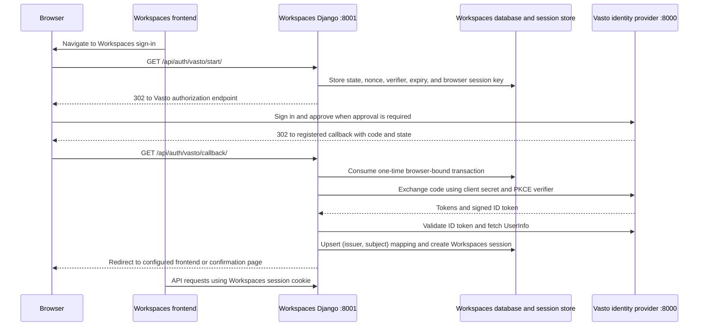

# Vasto Workspaces: Vasto OIDC client and authentication API

This guide explains how the Workspaces Django backend delegates sign-in to Vasto, validates the OIDC response, and establishes its own user session. It is the backend integration and API contract for developers working on Workspaces or its frontend client.

> **Implementation status:** The Django OIDC client, database-backed transaction handling, identity mapping, and session endpoints are implemented. Unit tests cover transaction validation and endpoint behavior. A live end-to-end login still requires both local services, a registered OAuth client, and valid provider credentials.

## Contents

- [Architecture](#architecture)
- [Local setup](#local-setup)
- [Environment variables](#environment-variables)
- [OIDC client flow](#oidc-client-flow)
- [Identity mapping](#identity-mapping)
- [Session lifecycle](#session-lifecycle)
- [Authentication API](#authentication-api)
- [Frontend integration contract](#frontend-integration-contract)
- [Security behavior](#security-behavior)
- [Local end-to-end walkthrough](#local-end-to-end-walkthrough)
- [Troubleshooting](#troubleshooting)
- [Frontend documentation boundary](#frontend-documentation-boundary)

## Architecture

Vasto is the identity provider and owns user authentication. Workspaces is a separate Django application and confidential OIDC client. Users do not create a second Workspaces password. Workspaces receives a verified Vasto identity, stores a local mapping, and owns the session cookie used on subsequent Workspaces requests.

The services do not share a database or a session cookie. Workspaces does not rely on Vasto's session for normal API calls. A still-active Vasto session may make a later authorization request faster, but it does not authenticate an existing Workspaces API request.



## Local setup

### Prerequisites and Python version

The repository pins Django 6.1.2 and Authlib 1.9.2 but does not currently declare a Python support range in a version file or README. The local environment used during implementation reported Python 3.14.4. Confirm the supported Python runtime for deployment before selecting a different version.

From the Workspaces repository root:

```sh
python --version
python -m venv .venv
source .venv/bin/activate
python -m pip install --upgrade pip
python -m pip install -r requirements.txt
cp .env.example .env
```

The Django project lives in `workspace/`. Settings load `.env` from the repository root. Start from that directory:

```sh
cd workspace
../.venv/bin/python manage.py migrate
../.venv/bin/python manage.py check
../.venv/bin/python manage.py runserver 127.0.0.1:8001
```

Local development uses SQLite by default at `workspace/db.sqlite3`. This is inside the Workspaces project and is separate from Vasto's PostgreSQL database. The project also supports PostgreSQL through a Workspaces-specific database URL, a generic deployment `DATABASE_URL`, or PostgreSQL `PG*` variables. See [Database configuration](#database-configuration).

The active settings module is `workspace.settings`. `manage.py` sets it when no explicit module is selected. Run the test suite and transaction cleanup command from `workspace/`:

```sh
../.venv/bin/python manage.py test identity.tests
../.venv/bin/python manage.py cleanup_auth_transactions
```

The cleanup command deletes expired authorization transaction rows. In deployed environments, schedule it periodically according to the service's operations policy.

## Environment variables

These names are read directly by `workspace/workspace/settings.py` and documented in the repository `.env.example`.

### Authentication and session

| Variable | Required? | Default / purpose |
|---|---|---|
| `VASTO_DISCOVERY_URL` | Yes for live sign-in | Local default `http://127.0.0.1:8000/o/.well-known/openid-configuration`; Authlib loads provider endpoints and JWKS from it. |
| `VASTO_ISSUER` | Yes for live sign-in | Local default `http://127.0.0.1:8000/o`; must match discovery and the ID token's `iss` exactly. |
| `VASTO_CLIENT_ID` | Yes for live sign-in | Client ID from the Vasto Application registered for this Workspaces environment. |
| `VASTO_CLIENT_SECRET` | Yes for live sign-in | Confidential client secret from that Vasto Application. Server-side only. |
| `VASTO_REDIRECT_URI` | Yes for live sign-in | Local default `http://127.0.0.1:8001/api/auth/vasto/callback/`; must exactly match Vasto's registered redirect URI. |
| `WORKSPACES_FRONTEND_URL` | Optional | If set, successful callback redirects there. If blank, the callback returns a simple development confirmation page. It is not a CORS allow-list. |
| `WORKSPACES_SECRET_KEY` | Required when `WORKSPACES_DEBUG=false` | Django signing/session secret. The development fallback is insecure and is rejected when debug is false. |
| `WORKSPACES_DEBUG` | Optional | Defaults to `true`; set false in production. Controls debug behavior and secure cookie/database fallback decisions. |
| `WORKSPACES_ALLOWED_HOSTS` | Optional | Comma-separated host allow-list; local defaults include `127.0.0.1`, `localhost`, and `0.0.0.0`. Use the real service hosts in deployment. |

Example local `.env` values; replace credentials with those from your own local Vasto admin registration:

```env
WORKSPACES_SECRET_KEY=generate-a-local-django-secret
WORKSPACES_DEBUG=true
WORKSPACES_ALLOWED_HOSTS=127.0.0.1,localhost

VASTO_DISCOVERY_URL=http://127.0.0.1:8000/o/.well-known/openid-configuration
VASTO_ISSUER=http://127.0.0.1:8000/o
VASTO_CLIENT_ID=your_local_client_id
VASTO_CLIENT_SECRET=your_local_client_secret
VASTO_REDIRECT_URI=http://127.0.0.1:8001/api/auth/vasto/callback/

WORKSPACES_FRONTEND_URL=
```

Generate a local Django secret, for example, with `python -c "import secrets; print(secrets.token_urlsafe(50))"`. The client secret is created/managed with the Vasto OAuth Application; it is not a Google secret and must not appear in frontend environment variables. Keep local, staging, and production credentials distinct.

### Database configuration

Workspaces never uses the Vasto database. Settings select the first applicable configuration in this order:

1. Non-empty `WORKSPACES_DATABASE_URL`.
2. Non-empty `DATABASE_URL` if the Workspaces-specific URL is not set.
3. PostgreSQL settings when any of `PGDATABASE`, `PGUSER`, `PGPASSWORD`, `PGHOST`, or `PGPORT` is supplied. `PGDATABASE` is required in this case.
4. SQLite at `workspace/db.sqlite3` when `WORKSPACES_DEBUG=true` and no database configuration was supplied.
5. An `ImproperlyConfigured` error when debug is false and no supported PostgreSQL configuration is supplied.

For PostgreSQL, provision a dedicated Workspaces database and use a Workspaces-only account. Prefer `WORKSPACES_DATABASE_URL` in deployment so a platform-wide `DATABASE_URL` cannot accidentally point to Vasto. Never copy Vasto's DB credentials or URL into this service.

### Other authentication-related settings

| Setting | Current value / behavior |
|---|---|
| `IDENTITY_TRANSACTION_TTL_SECONDS` | Fixed in settings at 600 seconds (10 minutes); not currently an environment variable. |
| Session engine | Django database-backed sessions (`django.contrib.sessions.backends.db`). |
| Session cookie | `workspaces_sessionid`, HttpOnly, SameSite=Lax, 14-day age; Secure when debug is false. |
| CSRF cookie | HttpOnly, SameSite=Lax; Secure when debug is false. |
| CORS | No Django CORS middleware or allowed-origin setting is configured in this repository. `WORKSPACES_FRONTEND_URL` only controls the post-callback redirect. |

The client credentials are sent only from Workspaces' backend to Vasto. Vasto's RSA private signing key is configured only on Vasto; Workspaces reads the public key from the discovered JWKS endpoint.

## OIDC client flow

The implementation is split across:

- `identity/views.py`: start, callback, session, logout, and identity mapping orchestration.
- `identity/services/vasto_oauth.py`: Authlib client registration, discovery, scope, and client authentication method.
- `identity/services/transactions.py`: state, nonce, PKCE verifier/challenge, expiry, browser binding, and one-time consumption.
- `identity/services/oidc.py`: ID-token verification, UserInfo retrieval, and claim allow-list.
- `identity/models.py`: `AuthorizationTransaction` and `VastoIdentity` records.

### Authorization initiation

`GET /api/auth/vasto/start/` creates a Django session if needed, then stores a random state, nonce, PKCE verifier, expiry, and session-key binding in `AuthorizationTransaction`. It derives the S256 code challenge from the verifier. Authlib builds a browser redirect from discovery metadata using `openid profile email` and the configured exact callback URI. The endpoint responds with an HTTP redirect; it does not return an `authorization_url` JSON object.

### Callback and code exchange

`GET /api/auth/vasto/callback/` requires the initiating browser's Workspaces session cookie and the original state. The callback consumes the state transaction atomically only when it is unexpired, unused, and bound to the same session. It rejects missing/invalid state and missing code. A response `iss` parameter is compared to `VASTO_ISSUER` if present; this view does not require the parameter to be present.

Workspaces loads discovery metadata and requires its `issuer` to equal `VASTO_ISSUER`. It exchanges the code at the discovered token endpoint using `client_secret_basic`, the exact redirect URI, and the saved PKCE verifier. Client secrets and token exchange stay on the backend.

### ID token and UserInfo validation

Authlib's `parse_id_token` validates the ID-token signature using the discovered JWKS, issuer, audience, expiration, and saved nonce. The code also explicitly requires the discovery issuer to match `VASTO_ISSUER` and rejects an ID token with no `sub`. It then fetches UserInfo over the server-side client and requires UserInfo `sub` to match the signed ID-token `sub`.

Only `issuer`, `subject`, `username`, `email`, and `email_verified` are retained locally. `issuer` and `subject` come from the ID token; username, email, and email-verification status come from UserInfo. Workspaces accepts `preferred_username` (with `name` as a fallback) for the local username. Email may be empty, and `email_verified` is true only when UserInfo returns the Boolean value `true`.

Authlib consumes the discovery JWKS rather than a hard-coded Vasto public key. The Workspaces repository has no custom JWKS cache or key-rotation implementation; provider metadata and key handling are delegated to Authlib. The implementation's exact refresh behavior for a key rotation depends on the pinned Authlib version and should be confirmed before relying on unusual rotation procedures.

## Identity mapping

`VastoIdentity` is one-to-one with the local Django user and has a database uniqueness constraint on `(issuer, subject)`. The local identity row stores issuer, subject, username, email, email verification status, and timestamps. The local Django username is made unique from the incoming username (or subject fallback). The local user is created with an unusable password.

- **Returning identity:** the existing `(issuer, subject)` mapping is found; username, email, and email verification snapshot are updated, and the same local user is returned.
- **New identity:** Workspaces creates a local Django user and a `VastoIdentity` mapping.
- **Same email, different subject:** the implementation does not merge by email. It treats the different `(issuer, subject)` as a separate identity and creates a separate local account, with a unique local username.
- **Concurrent first callback:** a uniqueness conflict falls back to fetching the identity row inserted by the concurrent request.
- **UserInfo or token validation failure:** callback processing is rejected and no authenticated Workspaces session is established.

Vasto is the source of the supported username and email snapshots. Workspaces-specific profile data is separate and is not populated by this OIDC mapping. Profile image, bio, school/institution, course/programme, and other student profile fields are not currently transferred by this integration.

## Session lifecycle

After a valid callback and identity mapping, Django `login()` creates a Workspaces authentication session in the Workspaces database. The browser receives the `workspaces_sessionid` cookie. The cookie is HttpOnly and SameSite=Lax; it is Secure when `WORKSPACES_DEBUG=false`. The configured session age is 14 days, and sessions use Django's database-backed session engine.

`GET /api/auth/me/` checks the Workspaces session and returns the mapped identity snapshot. Workspaces logout deletes only the local Workspaces session. It neither revokes Vasto's OAuth grant nor logs the browser out of Vasto. Conversely, logging out of Vasto does not terminate a currently valid Workspaces session. No global single logout is implemented.

After Workspaces logout, the browser may still have a Vasto session and remembered Workspaces authorization grant. Starting again can therefore return through Vasto without asking for the Vasto password or repeating consent, while creating a fresh Workspaces session. If the Vasto session has expired, Vasto requires the applicable authentication step and then resumes the pending authorization. Once a Workspaces session expires, `/api/auth/me/` returns 401; the frontend can start a new authorization when the user chooses to sign in again.

## Authentication API

The API base is `http://127.0.0.1:8001`. These routes are mounted under `/api/auth/` in `workspace/workspace/urls.py`.

### `GET /api/auth/vasto/start/`

- **Full local URL:** `http://127.0.0.1:8001/api/auth/vasto/start/`
- **Purpose:** Starts a browser-facing OIDC authorization redirect.
- **Authentication:** No Workspaces login required.
- **Query/body:** None required; any query parameters are not used as client authorization inputs.
- **Response:** `302` redirect to the Vasto authorization URL. The response creates/uses the Workspaces browser session required for callback binding.
- **Cookies:** Browser must retain and return `workspaces_sessionid` to the callback.
- **CSRF:** GET; no CSRF token required.
- **Common failure:** Missing client ID or secret raises a server configuration error; invalid discovery/network configuration prevents authorization URL creation.

This is a navigation endpoint. Do not call it as a cross-origin fetch and expect an `authorization_url` JSON property.

### `GET /api/auth/vasto/callback/`

- **Full local URL:** `http://127.0.0.1:8001/api/auth/vasto/callback/`
- **Purpose:** Browser-facing OAuth callback registered in the Vasto Application.
- **Authentication:** No pre-existing Workspaces authentication required. It does require the same browser session created at start.
- **Query parameters:** `state` and `code` on success; an OAuth `error` may be returned on denial. An authorization-response `iss` is checked if present.
- **Request body:** None; this is a GET protocol endpoint.
- **Success:** `302` to `WORKSPACES_FRONTEND_URL` if configured; otherwise `200 text/html` with a development confirmation page. Workspaces session cookie is established.
- **Errors:** `400` invalid/missing/expired/reused/session-mismatched transaction, issuer mismatch, or missing code; `403` when Vasto authorization was not completed; `401` when token/ID-token/UserInfo validation is rejected; `502` for discovery issuer mismatch or an unexpected callback/upstream failure.
- **Cookies/CSRF:** The browser must send the original Workspaces session cookie. OAuth state, nonce, PKCE, and session binding protect this callback; it is not a React API call. It is not exempted from Django middleware, but it is a GET protocol endpoint.

Do not manually visit or refresh a callback URL. The transaction is single-use and expires after ten minutes.

### `GET /api/auth/me/`

- **Full local URL:** `http://127.0.0.1:8001/api/auth/me/`
- **Purpose:** Reports whether the current browser has a valid Workspaces session.
- **Authentication:** Workspaces session cookie; no bearer token is used by this endpoint.
- **Query/body:** None.
- **CSRF:** GET; no CSRF token required.
- **Cookies:** Send browser credentials/session cookie.
- **Authenticated response:** `200 application/json`:

  ```json
  {
    "authenticated": true,
    "identity": {
      "username": "sample-user",
      "email": "sample@example.test",
      "email_verified": true
    }
  }
  ```

- **Unauthenticated or unmapped session:** `401 application/json`:

  ```json
  {"authenticated": false}
  ```

The endpoint does not expose `subject`, access tokens, or the client secret.

### `POST /api/auth/logout/`

- **Full local URL:** `http://127.0.0.1:8001/api/auth/logout/`
- **Purpose:** Logs out of the local Workspaces session only.
- **Authentication:** Requires an authenticated Workspaces session.
- **Query/body:** No body fields are read.
- **CSRF:** Required. The view uses Django CSRF protection and only accepts POST. Missing/invalid CSRF tokens produce Django's `403` CSRF response. An unauthenticated request with a valid CSRF context receives `401 application/json` with `{"authenticated": false}`.
- **Cookies:** Send the Workspaces session cookie and a valid CSRF token; the session is flushed on success.
- **Success:** `200 application/json`:

  ```json
  {"authenticated": false, "logged_out": true}
  ```

This endpoint does not revoke the Vasto grant or end the Vasto session. The current API has no dedicated JSON CSRF bootstrap endpoint, and `CSRF_COOKIE_HTTPONLY=true` prevents browser JavaScript from reading the cookie directly. The frontend and backend teams must agree on a secure CSRF-token bootstrap mechanism before a separate-origin browser frontend can call logout. Do not disable CSRF protection to work around this gap.

## Frontend integration contract

The frontend consumes `/api/auth/vasto/start/` for a user-initiated top-level navigation and `/api/auth/me/` to inspect the Workspaces session. The browser is redirected to the callback and then back to `WORKSPACES_FRONTEND_URL` when configured. The frontend should not call the callback as an ordinary XHR/fetch request.

For API calls, include browser credentials so the session cookie is sent:

```js
const response = await fetch('http://127.0.0.1:8001/api/auth/me/', {
  method: 'GET',
  credentials: 'include',
  headers: { Accept: 'application/json' },
});

if (response.status === 401) {
  // No current Workspaces session; offer the sign-in navigation.
}
```

To begin sign-in, navigate the browser to `http://127.0.0.1:8001/api/auth/vasto/start/`. To log out, use a CSRF-protected POST only after a token bootstrap path has been agreed and implemented.

**Cross-origin limitation:** Workspaces settings do not install CORS middleware or configure allowed frontend origins. `WORKSPACES_FRONTEND_URL` is only a post-callback redirect. A React app served from another origin cannot assume credentialed fetches will work as-is. A same-origin reverse proxy or an explicit, reviewed CORS and CSRF configuration is required. There is no frontend origin setting in the current backend API contract.

Cookies are scoped to the hostname rather than port. Use `127.0.0.1` consistently during local development; `localhost` is a separate cookie host. Workspaces uses the distinct `workspaces_sessionid` cookie name to avoid collisions with Vasto's local cookie.

## Security behavior

Implemented in the current backend:

- Confidential client with the client secret kept server-side and `client_secret_basic` authentication.
- Authorization Code flow with PKCE S256.
- Random state and nonce; state is bound to the initiating Workspaces session.
- Authorization transactions expire after 600 seconds, are atomically consumed, and cannot be replayed.
- Authlib validation of the RS256 ID-token signature, issuer, audience, expiration, and nonce using discovered JWKS.
- Explicit metadata issuer check, required ID-token subject, and UserInfo subject equality check.
- Same local identity determined by `(issuer, subject)`; no email-based account merge.
- Database-backed Workspaces sessions with HttpOnly cookies and secure cookies outside debug mode.
- Django CSRF middleware and explicit CSRF protection on logout.
- Error logs avoid returning raw OAuth/JWT validation data to the browser; the callback logs exception types for expected validation failures.

Future enhancements, not implemented: step-up MFA during new application authorization, additional profile claims, stronger account-linking flows, a dedicated CSRF bootstrap endpoint for a separate-origin SPA, CORS allow-list configuration, and global/single logout.

## Local end-to-end walkthrough

1. Start Vasto PostgreSQL and Redis, then Vasto at `http://127.0.0.1:8000` with `pwaninet.settings.local`.
2. Start Workspaces at `http://127.0.0.1:8001` after setting up its `.env`, migrating its own database, and running Django's development server.
3. In Vasto admin, register an environment-specific confidential Authorization Code Application. Set redirect URI exactly to `http://127.0.0.1:8001/api/auth/vasto/callback/`, leave skip authorization unchecked, and select RS256.
4. Copy the local client ID and raw client secret securely into Workspaces `.env`. Do not put them in React config. Confirm discovery's issuer is exactly `http://127.0.0.1:8000/o`.
5. Open `http://127.0.0.1:8001/api/auth/vasto/start/` in the browser.
6. Sign in to an existing Vasto account. A first-time Workspaces grant should show Vasto's consent form; a valid remembered grant may be approved automatically under the configured `auto` policy.
7. Confirm the browser reaches the Workspaces callback and then the configured frontend URL or local confirmation page.
8. Call `GET /api/auth/me/` from the same browser with credentials included; confirm the username, email, and email verification fields.
9. Refresh and call `/api/auth/me/` again to confirm the Workspaces database session persists.
10. For logout, first obtain a valid CSRF token through an agreed secure frontend integration; submit `POST /api/auth/logout/` with credentials and CSRF token.
11. Confirm `/api/auth/me/` returns 401 after logout. The Vasto session/grant may remain active, so starting again can be seamless.
12. To test expired Vasto login, end the Vasto session and begin a fresh Workspaces authorization. Vasto must return through login and then continue to consent/authorization as its grant policy requires.
13. Google login testing requires the developer to configure their own valid Vasto Google Identity Services credentials. It uses Vasto's existing Google login and is not a Workspaces Google client.

Useful unauthenticated endpoint checks:

```sh
curl -i http://127.0.0.1:8001/api/auth/me/
curl -i http://127.0.0.1:8001/api/auth/vasto/start/
```

The first should return 401 JSON. The second should return a redirect and may set the Workspaces session cookie. Avoid saving or sharing callback URLs, codes, tokens, cookie values, or secrets.

## Troubleshooting

| Symptom | Cause | Resolution |
|---|---|---|
| Django says `DATABASES` has no `ENGINE` | No URL/PG config was supplied and an earlier settings version selected an empty database configuration. | Current settings use local SQLite only when debug is on and no DB config is supplied. Set one supported PostgreSQL configuration in deployed environments; production refuses silent SQLite fallback. |
| Workspaces startup redirects to Vasto but Vasto is unavailable | Discovery URL uses the wrong host, path, scheme, or port. | Check `VASTO_DISCOVERY_URL` at `http://127.0.0.1:8000/o/.well-known/openid-configuration` and ensure Vasto is running. |
| Discovery or ID-token issuer mismatch | `VASTO_ISSUER` does not exactly match the issuer metadata/token. | Local value is `http://127.0.0.1:8000/o`; production issuer is separate and must use the production HTTPS issuer exactly. |
| Vasto reports invalid redirect URI | Callback differs from the URI on the OAuth Application (including host or trailing slash). | Set both sides to the exact environment URI; local callback is `http://127.0.0.1:8001/api/auth/vasto/callback/`. |
| Start raises a server error before redirect | `VASTO_CLIENT_ID` or `VASTO_CLIENT_SECRET` is blank, or discovery is unreachable/invalid. | Check Workspaces backend `.env`, restart the process after changes, and verify provider discovery. Never move the secret to frontend code. |
| Callback reports invalid/expired transaction | State is missing, mismatched, expired after 10 minutes, already consumed, or came back without the initiating Workspaces session cookie. | Restart at `/api/auth/vasto/start/` in the same browser profile and complete promptly. Do not replay callback URLs. |
| Callback reports invalid ID token | Signature, issuer, audience, expiry, nonce, subject, or UserInfo subject check failed. | Confirm discovery and issuer/client registration match; do not bypass validation. Restart with a fresh authorization transaction. |
| JWKS cannot be reached | Workspaces cannot reach the JWKS URL from discovery, or Vasto is not serving the signing key metadata. | Check discovery's `jwks_uri`, network reachability from Workspaces, and Vasto's local RSA key configuration. Never copy the private key to Workspaces. |
| `/api/auth/me/` remains unauthenticated after callback | Browser dropped the Workspaces session cookie, the callback did not complete, or the API is being called without credentials. | Use the same `127.0.0.1` host throughout and include credentials in browser API fetches. Check that `SESSION_COOKIE_SECURE` is compatible with local HTTP (`DEBUG=true`). |
| Login seems to be shared between local apps | Cookies are host-scoped across ports; old sessions could have used the same cookie name. | Use `127.0.0.1` consistently and distinct cookie names (`pwaninet_local_sessionid`, `workspaces_sessionid`). Clear old cookies for both `localhost` and `127.0.0.1` if needed. |
| Logout returns 403 | CSRF token missing/invalid; current settings make the CSRF cookie HttpOnly and the API has no JSON token-bootstrap endpoint. | Coordinate a secure bootstrap mechanism; do not remove CSRF protection. |
| Browser fetch reports CORS error | No CORS middleware or frontend origin allow-list is configured by this repository. | Use a same-origin reverse proxy or implement an explicit credentialed CORS and CSRF configuration through a separate reviewed change. |
| Consent page is skipped | Vasto found an unexpired grant for the same user, Workspaces Application, and scopes, with approval policy `auto`. | This is remembered consent. For first-consent testing, revoke only the specific local test user's Workspaces grant and ensure `skip_authorization=False`. |
| User signs in but callback continuation is lost | Vasto login/signup did not preserve the validated `next`, or a one-time Google continuation expired. | Check Vasto login/signup continuation handling and keep the original authorization URL intact; do not regenerate OAuth state, nonce, or PKCE values. |

## Frontend documentation boundary

This file documents the Workspaces backend authentication API and browser contract only. React repository setup, dependencies, environment configuration, server startup, navigation, and UI authentication states are maintained separately by the frontend team.
