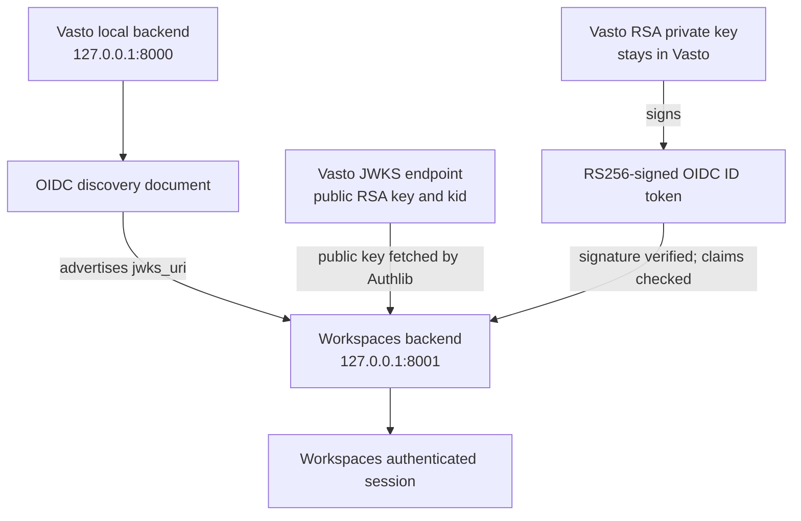

# Local Workspaces setup with a Vasto OIDC provider

This guide is a standalone onboarding path for a developer running Workspaces against Vasto. It covers local client configuration and a full browser sign-in, not the React repository's setup.

## Responsibility and key boundary

Vasto is the OAuth 2.0 / OpenID Connect identity provider. Workspaces is a confidential OAuth client with its own database, local identity mapping, and Django sessions. Workspaces does not share Vasto's Django session cookie and does not own or generate Vasto's signing key.

> **Never generate, request, copy, or store Vasto's RSA private signing key in Workspaces.** Vasto keeps that private key and uses it to sign ID tokens. Workspaces obtains Vasto's public signing key automatically through the `jwks_uri` in OIDC discovery and uses it to verify the ID-token signature. You do not manually copy either key into Workspaces.



The public key is safe to publish and is returned by the provider. The private signing key is not. The Workspaces OAuth **client secret** is a third, distinct value: it is generated for the Workspaces Application and authenticates the Workspaces backend at Vasto's token endpoint. It does not sign ID tokens and must never be placed in the frontend.

## Prerequisites and automated setup

The setup scripts use Bash. Run them directly in a Linux terminal (Ubuntu or Fedora) or macOS Terminal. Native Windows setup is not supported or verified: there is no PowerShell bootstrap, and the current scripts depend on Bash and Linux-style paths and file-permission commands. On Windows, use Ubuntu on WSL 2 and run all repository commands inside its terminal, not PowerShell or Command Prompt. For OS-specific tool installation, follow the [Workspaces README platform instructions](../../README.md#prepare-your-computer-by-operating-system); Vasto's OS-specific Docker instructions are in the Vasto README.

For a complete local integration, use the setup script in each backend. Each script reuses an activated or existing compatible Python environment, creating `.venv` only if none is found. The Vasto script validates its developer-owned RSA key, starts PostgreSQL and Redis, applies migrations, selects or creates an admin account, registers the Workspaces OAuth client, and provisions its external credentials file. The Workspaces script imports those credentials, prepares its own environment and database, and runs the live OIDC preflight. Neither script starts the long-running Django server.

## Scenario A: run both backends locally

### 1. Prepare and register Vasto

From the Vasto repository root, run:

```sh
./scripts/setup-dev.sh --developer YOUR_IDENTIFIER --owner-username YOUR_VASTO_ADMIN_USERNAME
```

Without these options, the script prompts for a developer identifier and lets you select an active staff account or create a superuser. It completes key validation, Compose startup (`db` and `redis`), database checks, migrations, and OAuth registration in one run. Use `--skip-containers` only when managing those services separately. The client credentials are written to `~/.config/vasto-workspaces/YOUR_IDENTIFIER-local.env` by default.

Start the prepared provider in a terminal. The example uses `.venv`; if setup reused another environment, use the exact server command printed by the script:

```sh
.venv/bin/python manage.py runserver 127.0.0.1:8000 --settings=pwaninet.settings.local
```

Vasto Admin is at `http://127.0.0.1:8000/admin/`; the local issuer is `http://127.0.0.1:8000/o`.

### 2. Prepare Workspaces and verify the provider

With Vasto running, from the Workspaces repository root run:

```sh
./scripts/setup-dev.sh --credentials-file ~/.config/vasto-workspaces/YOUR_IDENTIFIER-local.env
```

With no option, Workspaces automatically uses the only generated credentials file if there is one; otherwise it prompts for a file or securely collects the values. The script imports credentials without displaying the secret, checks and migrates the Workspaces-owned database, then runs `check_vasto_oidc` against live discovery and client registration. If preflight fails, fix the reported mismatch and rerun the same setup script. No separate migration, credential-import, or preflight command is needed.

Workspaces uses its own SQLite database at `workspace/db.sqlite3` by default. You may configure its own PostgreSQL database separately; never point Workspaces at Vasto's database.

### 3. Start Workspaces and test login

Start the prepared backend in another terminal. If setup reused an environment other than `.venv`, use the exact server command printed by its script:

```sh
.venv/bin/python workspace/manage.py runserver 127.0.0.1:8001
```

Then open `http://127.0.0.1:8001/api/auth/vasto/start/` and complete the browser sign-in below. Keep both servers on `127.0.0.1` consistently.

## Scenario B: Workspaces against shared development Vasto

If the team operates a shared development provider:

1. Do not generate, request, or copy that provider's private signing key.
2. Ask the provider owner for an approved client registration and credentials for your authorized local Workspaces callback. Do not share another developer's personal local secret.
3. Configure the discovery URL and exact issuer for the shared provider, plus the issued Workspaces client ID and secret. The issuer may differ from the local issuer; use the value published in that shared environment's discovery document exactly.
4. Workspaces retrieves the provider public signing key through the `jwks_uri` in discovery. Do not manually copy public or private key files into the Workspaces repository.
5. Start Workspaces locally as described above. Confirm the shared provider allows your registered callback and can be reached from your browser and Workspaces backend.

Only generate a Vasto key if you run your own Vasto provider instance (scenario A). The provider environment owns the key in scenario B.

## Verify discovery and JWKS

With Vasto running, check that the discovery document returns HTTP 200 and the expected local issuer:

```sh
curl -fsS http://127.0.0.1:8000/o/.well-known/openid-configuration | python -c '
import json, sys
metadata = json.load(sys.stdin)
print("Issuer:", metadata.get("issuer"))
print("Authorization endpoint:", metadata.get("authorization_endpoint"))
print("Token endpoint:", metadata.get("token_endpoint"))
print("UserInfo endpoint:", metadata.get("userinfo_endpoint"))
print("JWKS URI:", metadata.get("jwks_uri"))
print("ID-token signing algorithms:", metadata.get("id_token_signing_alg_values_supported"))
'

curl -fsS http://127.0.0.1:8000/o/.well-known/jwks.json >/dev/null
```

For a local Vasto instance, discovery should say `http://127.0.0.1:8000/o` for the issuer and list RS256 among ID-token signing algorithms. The JWKS URL should return a JSON key set containing an RSA public signing key. Authlib reads the JWKS URI automatically; no key copying or extra Workspaces key environment variable is needed.

The discovery issuer and signed ID-token `iss` must match Workspaces `VASTO_ISSUER` exactly. A change of scheme, host, port, or path is a different issuer and fails validation.

## Test the local sign-in

1. Confirm Vasto and Workspaces are both running at `127.0.0.1:8000` and `127.0.0.1:8001`.
2. Check discovery and JWKS using the commands above.
3. Confirm the Vasto Application is confidential, uses Authorization Code, has the exact local callback, has Skip Authorization unchecked, and uses RS256.
4. Confirm Workspaces `.env` contains the client ID and secret for that exact Application, plus the matching issuer, discovery URL, and callback URI. Restart Workspaces if you changed environment values.
5. In a browser, open `http://127.0.0.1:8001/api/auth/vasto/start/`. This is a browser redirect endpoint; it does not return an `authorization_url` JSON value.
6. Sign in to Vasto with a developer test account. Approve the consent request when Vasto asks. An existing matching grant can use remembered consent and skip the screen.
7. The browser should return to `http://127.0.0.1:8001/api/auth/vasto/callback/`. Successful callback means Workspaces exchanged the one-time authorization code, checked the ID-token signature and claims, fetched UserInfo, mapped the identity, and created the local Django session.
8. With the same browser and hostname, open `http://127.0.0.1:8001/api/auth/me/`. Expected authenticated response:

   ```json
   {
     "status": "success",
     "message": "Authenticated user profile retrieved successfully.",
     "authenticated": true,
     "user": {
       "id": 1,
       "username": "sample-user",
       "first_name": "Sample",
       "last_name": "User",
       "display_name": "Sample User",
       "email": "sample@example.test",
       "email_verified": true,
       "profile_picture": "https://pwaninet.app/media/profile_pic/sample.jpg",
       "status": "active"
     },
     "session": {
       "status": "active",
       "expires_at": "2026-11-03T13:30:00+00:00",
       "expires_in_seconds": 50400
     }
   }
   ```

   Workspaces imports the OIDC profile fields needed by the frontend: local user ID, username, names, email and verification status, and profile-picture URL. It does not expose the raw session key; the browser keeps that in its HttpOnly cookie. Bio, institution, and course data are not included in the current OIDC profile contract.

9. Refresh `/api/auth/me/`. It should continue to report authenticated while the Workspaces session remains valid.
10. Workspaces logout is `POST /api/auth/logout/` and requires CSRF. The backend does not currently expose a dedicated CSRF bootstrap endpoint, and its CSRF cookie is HttpOnly. Use an approved secure token-bootstrap mechanism if your local frontend/deployment provides one; without that, the browser logout request is expected to return 403. Do not disable CSRF to force the test. A successful logout returns `{"authenticated":false,"logged_out":true}`; a subsequent `/api/auth/me/` returns 401.
11. Start again from `/api/auth/vasto/start/`. A still-active Vasto login and previously approved grant may return quickly; Workspaces creates a new local session.

Useful unauthenticated API check:

```sh
curl -i http://127.0.0.1:8001/api/auth/me/
```

Without a Workspaces session cookie, this returns HTTP 401 with `{"authenticated":false}`. Do not save or share the callback URL, authorization code, token response, session cookie, client secret, or Vasto signing key.

## Troubleshooting

| Symptom | Diagnostic | Resolution |
|---|---|---|
| Discovery URL unavailable | Open the configured discovery URL and check that Vasto is listening on the expected host/port. | Start Vasto and use `http://127.0.0.1:8000/o/.well-known/openid-configuration` for local provider development. |
| Vasto JWKS returns 404 | Discovery's `jwks_uri` is wrong, Vasto is serving another revision/base path, or the URL is not the OIDC JWKS route. | Check the `jwks_uri` in discovery and request that exact endpoint; local default is `/o/.well-known/jwks.json`. |
| Vasto has no RSA key | Vasto's `OIDC_RSA_PRIVATE_KEY` setting is empty. | Generate the key on Vasto using its local key setup guide and confirm the Django shell parses it. Do not put a private key in Workspaces. |
| Issuer mismatch | Workspaces `VASTO_ISSUER` differs from discovery or ID-token `iss`. | Copy the exact issuer from the provider environment's discovery metadata into backend config, then restart Workspaces. |
| Redirect URI rejected | Vasto Application callback and Workspaces `VASTO_REDIRECT_URI` differ, including trailing slash, scheme, hostname, or port. | Use exact local callback `http://127.0.0.1:8001/api/auth/vasto/callback/` on both sides. |
| `invalid_client` at token exchange | Client ID/secret is missing, belongs to another Application/environment, or the secret was copied after hashing rather than before saving. | Reset the secret on the matching Vasto Application, capture it before saving, update Workspaces `.env`, and restart the backend. |
| ID-token signature cannot be verified | Workspaces cannot reach the discovered JWKS, the provider signing key changed, or the client sees stale provider metadata. | Check discovery and JWKS connectivity from the Workspaces environment, verify Vasto is using its stable local key, and restart the flow. Never bypass signature validation. |
| Authorization transaction invalid/expired | State is missing/replayed, expired after 10 minutes, bound to another Workspaces session, or the browser dropped the start-session cookie. | Start a fresh authorization in the same browser profile and finish promptly. Do not revisit an old callback URL. |
| Workspaces session disappears | Browser changed hostname between start/callback/me, dropped cookies, or debug/HTTPS cookie settings do not match the URL. | Use `127.0.0.1` consistently for both ports and use HTTP with `WORKSPACES_DEBUG=true` locally. |
| Logout returns 403 | Django rejected a missing or invalid CSRF token. | Use a valid token from an approved bootstrap mechanism. Current Workspaces API has no dedicated JSON CSRF bootstrap endpoint; do not turn off CSRF. |
| Frontend fetch reports CORS | Workspaces has no CORS middleware or origin allow-list configured. `WORKSPACES_FRONTEND_URL` is only a redirect destination. | Use a same-origin proxy or separately configure reviewed credentialed CORS and CSRF support. |
| Consent is skipped | Vasto has a valid remembered grant for the same user, Application, and scopes under its `auto` approval policy. | This is expected for a prior grant. For a first-consent test, revoke only the local test user's Workspaces grant in Vasto Admin. |

## Security checklist

- Vasto RSA private key stays on Vasto and is never copied to Workspaces.
- Workspaces client secret stays in the Workspaces backend environment, never frontend configuration or source control.
- The client secret and Vasto signing key are different credentials and must not be substituted for one another.
- Keep local and production credentials and signing keys separate.
- Keep local signing key file permissions restrictive and preserve the key across restarts.
- Do not automatically regenerate keys when starting Django.
- Use exact issuer and callback values and prefer consistent `127.0.0.1` browser URLs.
- Use separate local OAuth Application registrations where each developer runs an independent provider.

## Related Vasto guide

The Vasto repository's `docs/development/local-oidc-signing-key-setup.md` explains generating and safely verifying the provider's local private key. React repository setup and UI authentication behavior are documented separately by the frontend team.
