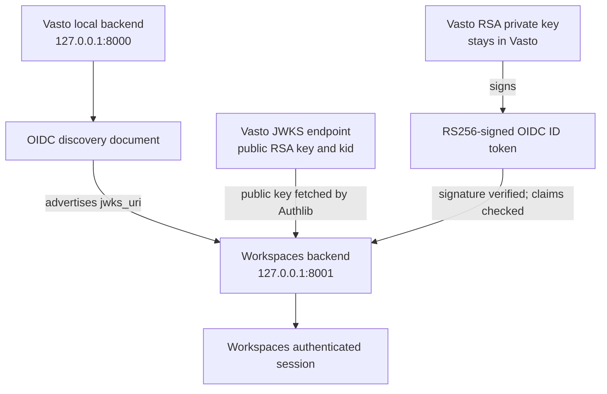

# Local Workspaces setup with a Vasto OIDC provider

This guide is a standalone onboarding path for a developer running Workspaces against Vasto. It covers local client configuration and a full browser sign-in, not the React repository's setup.

## Responsibility and key boundary

Vasto is the OAuth 2.0 / OpenID Connect identity provider. Workspaces is a confidential OAuth client with its own database, local identity mapping, and Django sessions. Workspaces does not share Vasto's Django session cookie and does not own or generate Vasto's signing key.

> **Never generate, request, copy, or store Vasto's RSA private signing key in Workspaces.** Vasto keeps that private key and uses it to sign ID tokens. Workspaces obtains Vasto's public signing key automatically through the `jwks_uri` in OIDC discovery and uses it to verify the ID-token signature. You do not manually copy either key into Workspaces.



The public key is safe to publish and is returned by the provider. The private signing key is not. The Workspaces OAuth **client secret** is a third, distinct value: it is generated for the Workspaces Application and authenticates the Workspaces backend at Vasto's token endpoint. It does not sign ID tokens and must never be placed in the frontend.

## Prerequisites

You can run a complete local two-server flow when:

- You have the Vasto repository and its local PostgreSQL/Redis environment configured.
- If you run your own Vasto provider, its local RSA signing key is generated and loaded by Vasto.
- Vasto's OAuth/OIDC endpoints are operational.
- You have the Workspaces repository and its Python environment configured.
- Workspaces migrations have been applied to its own database.
- A local Workspaces OAuth client is registered in your Vasto admin (or the team has issued credentials from a shared development Vasto).

Use scenario A if both servers run on your machine. Use scenario B if Workspaces uses a team-operated shared development provider. The shared provider's owner controls its signing key and application registrations.

## Prepare Workspaces locally

### Python and dependencies

The repository pins Django 6.1.2 and Authlib 1.9.2, but it does not declare a supported Python range in a `.python-version` file or README. The development runtime previously observed was Python 3.14.4. Confirm the team deployment runtime before choosing another interpreter.

From the Workspaces repository root:

```sh
python --version
python -m venv .venv
source .venv/bin/activate
python -m pip install --upgrade pip
python -m pip install -r requirements.txt
cp .env.example .env
```

The Django project is in `workspace/`. The settings module is `workspace.settings`; `manage.py` selects it by default. The project loads `.env` from the repository root. For the default local setup, Workspaces uses its own SQLite database at `workspace/db.sqlite3`; it needs no separate Redis service for this integration.

Apply Workspaces migrations and check the project:

```sh
cd workspace
../.venv/bin/python manage.py migrate
../.venv/bin/python manage.py check
```

Workspaces also supports PostgreSQL for deployment. Configure `WORKSPACES_DATABASE_URL`, `DATABASE_URL`, or `PGDATABASE` plus PostgreSQL connection variables only when using a separately provisioned Workspaces database. Never point Workspaces to Vasto's database.

## Scenario A: run both backends locally

### 1. Start your local Vasto provider

Follow Vasto's standard repository setup from its repository root: create a Python environment, install `requirements.txt`, configure `.env`, and start the repository's PostgreSQL and Redis services:

```sh
docker compose up -d db redis
```

The current Vasto Compose file publishes PostgreSQL on host port 5432, while Vasto `.env.example` lists `DB_PORT=5433`. Set your local `.env` to `DB_PORT=5432` for the checked-in Compose configuration, or make both values agree if you intentionally change the Compose mapping. Generate and verify a local signing key by following Vasto's `docs/development/local-oidc-signing-key-setup.md`; the path it uses is Vasto's ignored `.secrets/oidc_rsa_private.pem`.

Run Vasto's migrations and development server in a terminal:

```sh
python manage.py migrate --settings=pwaninet.settings.local
python manage.py check --settings=pwaninet.settings.local
python manage.py runserver 127.0.0.1:8000 --settings=pwaninet.settings.local
```

Vasto Admin is at `http://127.0.0.1:8000/admin/`. Its local issuer is `http://127.0.0.1:8000/o`.

### 2. Register a Workspaces client in Vasto Admin

The OAuth client registration belongs in **Vasto Admin**, not Workspaces Admin. Sign in using an authorized Vasto staff account. Open **OAuth2 Provider → Applications → Add application** and create a separate local record for your local Workspaces backend.

Use these settings:

| Application field | Local value | Notes |
|---|---|---|
| Name | `Vasto Workspaces (Local)` or another clear developer-specific local name | The inspected local registration uses `Vasto Workspaces (Local)`. Independent local providers should have their own record. |
| User | An authorized Vasto admin/owner | This is the registration owner, not the person who will later sign in through Workspaces. |
| Client type | Confidential | The secret stays in the Workspaces backend. |
| Authorization grant type | Authorization code | Workspaces uses the browser authorization-code flow. |
| Redirect URIs | `http://127.0.0.1:8001/api/auth/vasto/callback/` | Match the Workspaces setting exactly, including the trailing slash. |
| Post logout redirect URIs | Leave unset | Workspaces does not implement global or provider logout. |
| Skip authorization | Unchecked | Vasto may show its consent form for a new grant. Remembered grants can be approved automatically by Vasto's `auto` policy. |
| Algorithm | RSA with SHA-2 256 (`RS256`) | Matches Vasto's RSA signing configuration. |
| Hash client secret | Enabled | Copy the new secret before saving; a hashed secret cannot be read back as plaintext. |
| Allowed origins | Leave blank for this server-side backend client | This is not React CORS configuration. |
| Registration source | `manual` (admin-created) | Vasto/DOT records admin-created Applications as manual registrations. |

Save the Application and securely capture the generated **Client ID** and **Client Secret** for your Workspaces `.env`. The client secret is separate from the Vasto RSA signing key. Do not send credentials to another developer or reuse the repository owner's personal client secret. If a secret is lost or exposed, reset it for this Application in Vasto Admin, capture the new plaintext value before saving, update Workspaces `.env`, and restart Workspaces. If tokens were also exposed, revoke only the affected application's tokens/grants in Vasto.

### 3. Configure Workspaces client settings

The implemented variable names are `VASTO_DISCOVERY_URL`, `VASTO_ISSUER`, `VASTO_CLIENT_ID`, `VASTO_CLIENT_SECRET`, and `VASTO_REDIRECT_URI` (the variable names in this repository do not use the illustrative `VASTO_OIDC_*` prefix). Put the client ID and secret in the Workspaces backend `.env` only:

```env
WORKSPACES_SECRET_KEY=your-local-django-secret
WORKSPACES_DEBUG=true
WORKSPACES_ALLOWED_HOSTS=127.0.0.1,localhost

VASTO_DISCOVERY_URL=http://127.0.0.1:8000/o/.well-known/openid-configuration
VASTO_ISSUER=http://127.0.0.1:8000/o
VASTO_CLIENT_ID=your_local_client_id
VASTO_CLIENT_SECRET=your_local_client_secret
VASTO_REDIRECT_URI=http://127.0.0.1:8001/api/auth/vasto/callback/

WORKSPACES_FRONTEND_URL=
```

`VASTO_DISCOVERY_URL` tells Authlib where provider metadata lives; `VASTO_ISSUER` is checked against discovery and the ID token; the client ID and secret identify/authenticate this backend Application; and `VASTO_REDIRECT_URI` must match Vasto Admin exactly. If `WORKSPACES_FRONTEND_URL` is blank, successful callback shows a simple development confirmation page. It is a redirect destination, not a CORS allow-list.

Never place the client secret in React `.env` files or browser JavaScript. Never commit the Workspaces `.env`. Workspaces must not have `OIDC_RSA_PRIVATE_KEY` or a copy of Vasto's `.secrets` directory.

### 4. Start Workspaces

In a second terminal, from the Workspaces repository root, with its virtual environment active:

```sh
cd workspace
../.venv/bin/python manage.py migrate
../.venv/bin/python manage.py check
../.venv/bin/python manage.py runserver 127.0.0.1:8001
```

Workspaces is now available at `http://127.0.0.1:8001`. Use `127.0.0.1` consistently in both repositories; do not mix it with `localhost` during the same sign-in. The browser treats these hostnames as different cookie scopes. Ports do not isolate cookies, so the apps use distinct local session cookie names.

## Scenario B: Workspaces against shared development Vasto

If the team operates a shared development provider:

1. Do not generate, request, or copy that provider's private signing key.
2. Ask the provider owner for an approved client registration and credentials for your authorized local Workspaces callback. Do not share another developer's personal local secret.
3. Configure the discovery URL and exact issuer for the shared provider, plus the issued Workspaces client ID and secret. The issuer may differ from the local issuer; use the value published in that shared environment's discovery document exactly.
4. Workspaces retrieves the provider public signing key through the `jwks_uri` in discovery. Do not manually copy public or private key files into the Workspaces repository.
5. Start Workspaces locally as described above. Confirm the shared provider allows your registered callback and can be reached from your browser and Workspaces backend.

Only generate a Vasto key if you run your own Vasto provider instance (scenario A). The provider environment owns the key in scenario B.

## Verify discovery and JWKS

With Vasto running, check that the discovery document returns HTTP 200 and the expected local issuer:

```sh
curl -fsS http://127.0.0.1:8000/o/.well-known/openid-configuration | python -c '
import json, sys
metadata = json.load(sys.stdin)
print("Issuer:", metadata.get("issuer"))
print("Authorization endpoint:", metadata.get("authorization_endpoint"))
print("Token endpoint:", metadata.get("token_endpoint"))
print("UserInfo endpoint:", metadata.get("userinfo_endpoint"))
print("JWKS URI:", metadata.get("jwks_uri"))
print("ID-token signing algorithms:", metadata.get("id_token_signing_alg_values_supported"))
'

curl -fsS http://127.0.0.1:8000/o/.well-known/jwks.json >/dev/null
```

For a local Vasto instance, discovery should say `http://127.0.0.1:8000/o` for the issuer and list RS256 among ID-token signing algorithms. The JWKS URL should return a JSON key set containing an RSA public signing key. Authlib reads the JWKS URI automatically; no key copying or extra Workspaces key environment variable is needed.

The discovery issuer and signed ID-token `iss` must match Workspaces `VASTO_ISSUER` exactly. A change of scheme, host, port, or path is a different issuer and fails validation.

## Test the local sign-in

1. Confirm Vasto and Workspaces are both running at `127.0.0.1:8000` and `127.0.0.1:8001`.
2. Check discovery and JWKS using the commands above.
3. Confirm the Vasto Application is confidential, uses Authorization Code, has the exact local callback, has Skip Authorization unchecked, and uses RS256.
4. Confirm Workspaces `.env` contains the client ID and secret for that exact Application, plus the matching issuer, discovery URL, and callback URI. Restart Workspaces if you changed environment values.
5. In a browser, open `http://127.0.0.1:8001/api/auth/vasto/start/`. This is a browser redirect endpoint; it does not return an `authorization_url` JSON value.
6. Sign in to Vasto with a developer test account. Approve the consent request when Vasto asks. An existing matching grant can use remembered consent and skip the screen.
7. The browser should return to `http://127.0.0.1:8001/api/auth/vasto/callback/`. Successful callback means Workspaces exchanged the one-time authorization code, checked the ID-token signature and claims, fetched UserInfo, mapped the identity, and created the local Django session.
8. With the same browser and hostname, open `http://127.0.0.1:8001/api/auth/me/`. Expected authenticated response:

   ```json
   {
     "authenticated": true,
     "identity": {
       "username": "sample-user",
       "email": "sample@example.test",
       "email_verified": true
     }
   }
   ```

   The current Workspaces identity data is username, email, and email verification status. It does not yet import profile image, bio, institution, or course details.

9. Refresh `/api/auth/me/`. It should continue to report authenticated while the Workspaces session remains valid.
10. Workspaces logout is `POST /api/auth/logout/` and requires CSRF. The backend does not currently expose a dedicated CSRF bootstrap endpoint, and its CSRF cookie is HttpOnly. Use an approved secure token-bootstrap mechanism if your local frontend/deployment provides one; without that, the browser logout request is expected to return 403. Do not disable CSRF to force the test. A successful logout returns `{"authenticated":false,"logged_out":true}`; a subsequent `/api/auth/me/` returns 401.
11. Start again from `/api/auth/vasto/start/`. A still-active Vasto login and previously approved grant may return quickly; Workspaces creates a new local session.

Useful unauthenticated API check:

```sh
curl -i http://127.0.0.1:8001/api/auth/me/
```

Without a Workspaces session cookie, this returns HTTP 401 with `{"authenticated":false}`. Do not save or share the callback URL, authorization code, token response, session cookie, client secret, or Vasto signing key.

## Troubleshooting

| Symptom | Diagnostic | Resolution |
|---|---|---|
| Discovery URL unavailable | Open the configured discovery URL and check that Vasto is listening on the expected host/port. | Start Vasto and use `http://127.0.0.1:8000/o/.well-known/openid-configuration` for local provider development. |
| Vasto JWKS returns 404 | Discovery's `jwks_uri` is wrong, Vasto is serving another revision/base path, or the URL is not the OIDC JWKS route. | Check the `jwks_uri` in discovery and request that exact endpoint; local default is `/o/.well-known/jwks.json`. |
| Vasto has no RSA key | Vasto's `OIDC_RSA_PRIVATE_KEY` setting is empty. | Generate the key on Vasto using its local key setup guide and confirm the Django shell parses it. Do not put a private key in Workspaces. |
| Issuer mismatch | Workspaces `VASTO_ISSUER` differs from discovery or ID-token `iss`. | Copy the exact issuer from the provider environment's discovery metadata into backend config, then restart Workspaces. |
| Redirect URI rejected | Vasto Application callback and Workspaces `VASTO_REDIRECT_URI` differ, including trailing slash, scheme, hostname, or port. | Use exact local callback `http://127.0.0.1:8001/api/auth/vasto/callback/` on both sides. |
| `invalid_client` at token exchange | Client ID/secret is missing, belongs to another Application/environment, or the secret was copied after hashing rather than before saving. | Reset the secret on the matching Vasto Application, capture it before saving, update Workspaces `.env`, and restart the backend. |
| ID-token signature cannot be verified | Workspaces cannot reach the discovered JWKS, the provider signing key changed, or the client sees stale provider metadata. | Check discovery and JWKS connectivity from the Workspaces environment, verify Vasto is using its stable local key, and restart the flow. Never bypass signature validation. |
| Authorization transaction invalid/expired | State is missing/replayed, expired after 10 minutes, bound to another Workspaces session, or the browser dropped the start-session cookie. | Start a fresh authorization in the same browser profile and finish promptly. Do not revisit an old callback URL. |
| Workspaces session disappears | Browser changed hostname between start/callback/me, dropped cookies, or debug/HTTPS cookie settings do not match the URL. | Use `127.0.0.1` consistently for both ports and use HTTP with `WORKSPACES_DEBUG=true` locally. |
| Logout returns 403 | Django rejected a missing or invalid CSRF token. | Use a valid token from an approved bootstrap mechanism. Current Workspaces API has no dedicated JSON CSRF bootstrap endpoint; do not turn off CSRF. |
| Frontend fetch reports CORS | Workspaces has no CORS middleware or origin allow-list configured. `WORKSPACES_FRONTEND_URL` is only a redirect destination. | Use a same-origin proxy or separately configure reviewed credentialed CORS and CSRF support. |
| Consent is skipped | Vasto has a valid remembered grant for the same user, Application, and scopes under its `auto` approval policy. | This is expected for a prior grant. For a first-consent test, revoke only the local test user's Workspaces grant in Vasto Admin. |

## Security checklist

- Vasto RSA private key stays on Vasto and is never copied to Workspaces.
- Workspaces client secret stays in the Workspaces backend environment, never frontend configuration or source control.
- The client secret and Vasto signing key are different credentials and must not be substituted for one another.
- Keep local and production credentials and signing keys separate.
- Keep local signing key file permissions restrictive and preserve the key across restarts.
- Do not automatically regenerate keys when starting Django.
- Use exact issuer and callback values and prefer consistent `127.0.0.1` browser URLs.
- Use separate local OAuth Application registrations where each developer runs an independent provider.

## Related Vasto guide

The Vasto repository's `docs/development/local-oidc-signing-key-setup.md` explains generating and safely verifying the provider's local private key. React repository setup and UI authentication behavior are documented separately by the frontend team.
